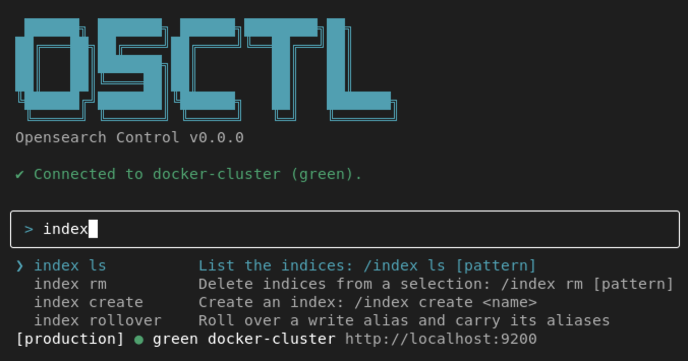

# osctl

[](https://github.com/jboix/osctl/actions/workflows/quality.yml)
[](https://www.npmjs.com/package/osctl)
[](https://nodejs.org)
[](./LICENSE)

osctl is an interactive terminal interface, built with [Ink](https://github.com/vadimdemedes/ink),
for managing OpenSearch clusters. It is an alternative to curl and the REST API for routine
administration. It also removes some ceremony, like resolving `seq_no` and `primary_term` on policy
updates and carrying aliases over a rollover.

<p align="center">
  
</p>

## Quick start

Install with npm (Node 20 or later):

```bash
npm install -g osctl
```

Or just run it with npx:

```bash
npx osctl
```

Standalone binaries are also available. The installation script keeps versions side by side and
points a `current` symlink at the active one; run it again to update, or with `-v <version>` to pin
or roll back:

```bash
mkdir -p ~/.osctl && cd ~/.osctl
wget https://raw.githubusercontent.com/jboix/osctl/main/install-osctl.sh
chmod +x install-osctl.sh
./install-osctl.sh
export PATH="$HOME/.osctl/current:$PATH"
```

To install by hand, take the archive for your platform from the
[releases page](https://github.com/jboix/osctl/releases) and extract it. The archive carries the
execute bit, and `SHA256SUMS` lists the checksum of every archive:

```bash
tar -xzf osctl-linux-x64.tar.gz
./osctl
```

Then start osctl and connect to a cluster:

```bash
osctl
> /profile add
```

## Commands

| Family       | Commands                                                               |
| ------------ | ---------------------------------------------------------------------- |
| `/index`     | `ls`, `create`, `rm`, `rollover`, `show`, `settings`, `settings apply` |
| `/alias`     | `ls`, `apply`, `rm`                                                    |
| `/template`  | `ls`, `show`, `apply`, `rm`                                            |
| `/component` | `ls`, `show`, `apply`, `rm`                                            |
| `/policy`    | `ls`, `show`, `apply`, `rm`, `explain`                                 |
| `/cluster`   | `info`, `settings`, `settings apply`, `nodes`, `explain`               |
| `/task`      | `ls`, `show`, `cancel`                                                 |
| `/snapshot`  | `repo ls`, `ls`, `show`, `create`, `restore`, `rm`                     |
| `/reindex`   | run a reindex as a background task                                     |
| `/backup`    | `ls`, `show`, `apply`, `rm`                                            |
| `/profile`   | `add`, `ls`, `default`, `rm`                                           |

> \[!TIP]
> Listings and removals accept glob patterns: `/index ls core_*`.

See [docs/design/commands.md](docs/design/commands.md) for the arguments, behavior, and
backing API of each command.

## Contributing

See the [contributing guide](docs/CONTRIBUTING.md). Participation is governed by the
[Code of Conduct](docs/CODE_OF_CONDUCT.md). Report security problems privately, as the
[security policy](docs/SECURITY.md) describes.

## License

MIT, see [LICENSE](LICENSE).
